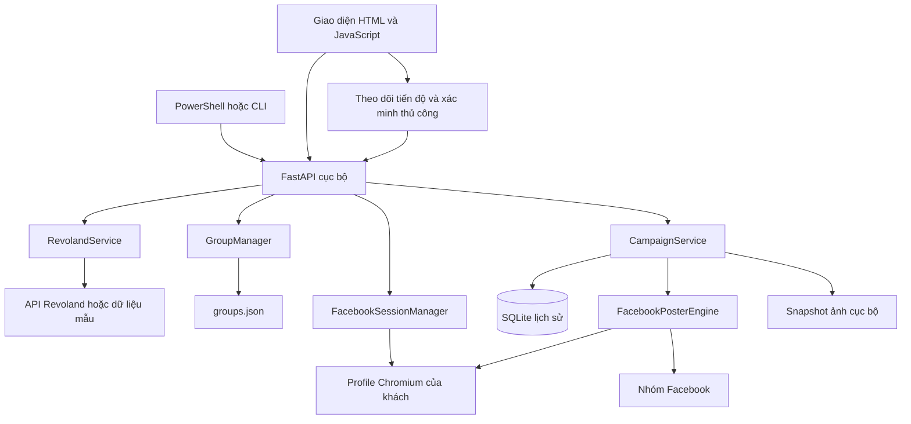

# Luồng hoạt động của project

> Tài liệu lưu trữ trước đợt sắp xếp 02/11/2026. Nội dung và số dòng mô tả phiên bản cũ; xem [kiến trúc hiện tại](../ARCHITECTURE.md) và [báo cáo rà soát](../PROJECT_REVIEW.md).

**Luồng hiện tại (Facebook 4.0):** `/` → `workflow.js` → `WebsiteSourceService` nhập JSON/JSON-LD và snapshot ảnh → preview + duyệt → `CampaignService` nhận `SnapshotProvider` → poster nhóm → kết quả có permalink/evidence → `/api/workflow/.../comments` → `LeadFilterService` lưu context căn/chiến dịch/nhóm → `/leads?run=...` → lọc ba mức và Excel. Hướng dẫn đầy đủ ở [FACEBOOK_WORKFLOW.md](../FACEBOOK_WORKFLOW.md). Threads/Zalo để sau.

**Cập nhật 29/10/2026:** Dashboard chính là [luồng lọc lead](../LEAD_FILTER.md): Facebook → bình luận → registry → kết quả/Excel. Các mục 1–13 dưới đây mô tả công cụ đăng bài cũ ở `/posting`; phần cuối ghi luồng lọc lead mới.

Đọc cùng [CODE_REVIEW.md](CODE_REVIEW_2026-10-28.md) để phân biệt thiết kế mong muốn với lỗi còn lại; [FUNCTION_REFERENCE.md](FUNCTION_REFERENCE_2026-10.md) giải thích từng hàm theo file và số dòng.

## 1. Các khối chính

Không có React hoặc dịch vụ Node trong luồng chạy. Giao diện dùng JavaScript thuần; Python FastAPI nhận HTTP; Playwright điều khiển Chromium. `RevolandService` lấy căn, còn `RevolandClient` tạo lead ở module thử nghiệm — hai lớp khác nhau.

## 2. Khởi động và xác định khách

`install.ps1` tạo môi trường Python, cài dependency và Chromium. `start.ps1 -Customer khach01` chọn thư mục `%LOCALAPPDATA%\RevolandFBPoster\khach01`, đặt quyền thư mục, đặt biến `REVOLAND_DATA_DIR` rồi chạy `cli.py --server`.

`config/settings.py` đọc biến môi trường ngay khi import. Mỗi tiến trình có một runtime riêng; đổi khách cần tiến trình/thư mục/cổng riêng. Không có màn hình đăng nhập vào chính dashboard và không phải web server nhiều người dùng.

CLI tạo các service rồi Uvicorn nạp `api.server:app`; module server cũng tạo service cho request HTTP. `CampaignService` khởi tạo SQLite, nhập lịch sử cũ một lần và phục hồi task bị gián đoạn. Server bind `127.0.0.1`, mặc định cổng 8000, một worker và không tự reload.

## 3. Giao diện tải lần đầu

`window.onload` chạy kiểm tra phiên, tải cấu hình/chế độ dữ liệu, tải căn và tải nhóm; sau đó đọc lịch sử, mở chiến dịch đang chạy hoặc chiến dịch gần nhất. JavaScript gọi API qua hàm `api()`, thêm header X-Revoland-Client và xử lý response lỗi.

Backend kiểm tra Host và Origin, yêu cầu header đối với thao tác thay đổi dữ liệu. Đây là lớp bảo vệ cho ứng dụng cục bộ, không thay thế đăng nhập/phân quyền trên một hệ thống công khai.

## 4. Cấu hình Revoland

Giao diện lấy cấu hình từ `GET /api/config`; key không trả về. `POST /api/config` ghép dữ liệu nhập với cấu hình hiện có, kiểm tra URL và khoảng nghỉ, lưu JSON nguyên tử rồi cập nhật cấu hình các service trong tiến trình. Key trống giữ key cũ.

Nút Lưu & kiểm tra kết nối lưu trước rồi gọi `POST /api/revoland/test-connection`. Adapter thử `GET base/ping` với Bearer key. Mock mode chỉ báo chế độ mẫu hoạt động, không chứng minh đã kết nối Revoland.

## 5. Đăng nhập Facebook và giữ phiên

`POST /api/session/login` khởi động thread đăng nhập. `FacebookSessionManager` khóa profile, mở Chromium có giao diện và chờ tối đa 180 giây. Khách tự nhập mật khẩu và OTP trên Facebook. Tool kiểm tra cookie c_user, dấu hiệu UI và URL không thuộc luồng xác minh trước khi báo thành công.

`launch_persistent_context` dùng lại thư mục profile nên cookie/storage còn hiệu lực được tái sử dụng ở lần sau. Tool không yêu cầu nhập lại mật khẩu mỗi lần đăng. Khi hết phiên hoặc checkpoint, khách phải thao tác lại; không có cam kết đăng nhập một lần mãi mãi.

`GET /api/session/status` có thể mở Chromium headless để xác minh phiên. Nếu profile đang bận thì trả busy. `POST /api/session/logout` xóa dữ liệu phiên cục bộ khi lấy được khóa; không tự thu hồi mọi phiên Facebook trên máy khác.

## 6. Chọn căn, nhóm và xem trước

`GET /api/revoland/listings` gọi adapter lấy các trang dữ liệu. Adapter hỗ trợ mảng hoặc một số envelope data/listings và last_page. Lỗi API live được báo lỗi, không thay bằng căn mẫu. Hợp đồng thật vẫn cần xác nhận.

Chọn căn gọi endpoint preview: backend lấy lại căn, định dạng nội dung rồi trả nội dung, URL ảnh và hash JSON của căn. Khách sửa nội dung ngay trên preview. Số previewGeneration ở frontend ngăn response của căn chọn trước ghi đè căn chọn sau.

Nhóm được lưu qua GroupManager vào groups.json. URL được chuẩn hóa về www.facebook.com/groups/slug, bỏ query và kiểm tra trùng. UI không tự tìm nhóm tài khoản đang tham gia; khách nhập/chọn danh sách mình quản lý.

## 7. Bấm đăng: tạo campaign trước, thực thi sau

`POST /api/campaigns/create` gửi ID căn, danh sách nhóm, nội dung khách sửa và preview_token. `create_campaign()` kiểm tra căn còn hợp lệ và hash chưa đổi, chuẩn hóa/loại nhóm trùng, kiểm tra lịch sử, tải toàn bộ ảnh xuống snapshot riêng, tạo một task mỗi nhóm rồi ghi SQLite.

Một campaign là một căn với nhiều nhóm; một task là một lần xử lý cho một nhóm. `media_urls` trong PropertyListing là URL bên ngoài, nhưng cùng tên trường trong PostingCampaign lại chứa đường dẫn ảnh local.

`POST /api/campaigns/{id}/execute` đặt lịch chạy thread và trả queued; không giữ request đến khi đăng xong. Campaign mẫu/legacy hoặc đang có unknown bị chặn chạy. Việc đọc trạng thái và chuyển queued diễn ra sau khi lấy cả khóa runner và khóa file, tránh ghi đè bằng snapshot cũ.

## 8. Thực thi từng nhóm

Worker lấy campaign, chuyển running và duyệt task. Trước mỗi lần gửi, tool kiểm tra lại lịch sử theo ID căn và URL nhóm để tránh các campaign tạo trước cùng đăng lại. Nhóm bị xóa/tạm dừng/đổi URL được báo lỗi.

PosterEngine khóa profile, dùng phiên hiện có mở nhóm, kiểm tra xác thực, mở composer, nhập đủ nội dung, so sánh nội dung soạn và đính kèm ảnh. Ảnh giao diện/avatar có sẵn không tính vào upload; phải có đủ ảnh mới trong tile đính kèm, tải thành công và hết trạng thái bận. Draft cũ có ảnh sẽ bị chặn.

Ngay trước click gửi, callback `before_submit()` lưu submission_started=True vào SQLite. Nhờ đó nếu app tắt sau click nhưng chưa nhận kết quả, lần mở lại sẽ coi task là unknown, không tự gửi lại.

Sau click, engine tìm bài có toàn bộ nội dung, permalink mới và timestamp Vừa xong/Just now; hoặc thông báo xác nhận chờ duyệt. Nếu không xác nhận được trong thời gian chờ thì unknown. Có checkpoint sau gửi cũng là unknown vì không biết Facebook đã nhận bài hay chưa.

Kết quả mỗi task được lưu. Gặp action_required hoặc unknown thì dừng các nhóm tiếp theo; còn lại nghỉ giữa nhóm theo cấu hình rồi tiếp tục. Chưa có nút hủy hoặc tự lên lịch đăng vào giờ tương lai.

## 9. Theo dõi, retry và xác minh

Frontend đọc campaign mỗi khoảng một giây. Bảng kết quả lấy trạng thái từ SQLite qua API. Tải lại trang vẫn đọc được lịch sử.

| Task status | Ý nghĩa và thao tác |
|---|---|
| pending | Chưa gửi; nút tiếp tục xử lý phần còn lại |
| running | Đang thao tác; chưa phải thành công |
| posted | Engine có bằng chứng hoặc khách đã xác nhận permalink |
| pending_approval | Đã xác nhận chờ duyệt; chưa đồng nghĩa bài xuất hiện công khai |
| failed | Thất bại trước gửi, hoặc khách xác nhận chưa gửi/bị từ chối; có thể retry |
| action_required | Cần khách xử lý phiên/quyền hoặc đợi trình duyệt; giải quyết rồi retry |
| unknown | Có khả năng đã gửi; phải kiểm tra nhóm trước khi quyết định |
| skipped_duplicate | Căn đã đăng/đang duyệt ở cùng URL nhóm; không gửi lại |

Retry chỉ chọn failed/action_required, không chọn posted/pending_approval/unknown. Nút tiếp tục dùng execute nên cũng có thể xử lý task failed/action_required cùng các pending. Không có cơ chế tự kiểm tra định kỳ bài pending đã được admin duyệt; khách xác minh qua nút kiểm tra và xác nhận.

Campaign có status tổng hợp riêng như created, queued, running, completed, partial_failed, paused, needs_review, interrupted. Completed không có nghĩa mọi task đều là posted: có thể gồm pending_approval và skipped_duplicate.

## 10. Dữ liệu lưu ở đâu

| Dữ liệu | Nơi lưu trong runtime khách |
|---|---|
| API key và cấu hình | config/config.json |
| Nhóm mục tiêu | config/groups.json |
| Phiên Facebook | profiles/fb_user_profile/ |
| Lịch sử campaign và task | data/campaigns.sqlite3 |
| Ảnh snapshot | data/temp_images/ |
| Lịch sử JSON cũ nếu có | data/campaigns_history.json; file gốc giữ nguyên |

JSON được ghi qua file tạm rồi replace. SQLite dùng transaction; campaign và task hiện vẫn đóng gói JSON trong một cột. Khóa browser và khóa chiến dịch là hai lớp khác nhau.

## 11. Nhánh thử nghiệm sau MVP

BrowserLeadManager có thể đọc text trên trang, đưa qua RegistryFilterEngine, trích điện thoại/email/Zalo và xuất Excel. Selector hiện rộng, không bảo đảm text nào cũng là bình luận thật hoặc gắn đúng người viết.

CommentPipeline nhận bình luận → băm chống trùng → lọc quy tắc → tạo lead hoặc đưa hàng chờ duyệt. Bộ lọc dùng JSON registry, không dùng LLM. RevolandClient mặc định mock và tạo lead qua endpoint /leads khi bật live riêng; cấu hình đó chưa dùng chung dashboard.

FacebookService là luồng manual-assisted cũ: tạo payload để copy, lưu tác vụ trong RAM và người dùng đánh dấu posted. Nó không phải engine Playwright của dashboard và chưa triển khai Graph API.

Nhánh tự crawl và tạo lead chưa được nối vào giao diện MVP. Dashboard hiện có nhập JSON bình luận/lead để lọc và xuất Excel qua ReportService; đây là thao tác báo cáo độc lập, không tự thu thập Facebook hoặc tạo lead trên Revoland.

## 13. Luồng xuất file

Nút xuất kết quả gọi GET /api/exports/campaigns, tùy chọn campaign_id. ReportService đọc SQLite hiện tại và ExcelExporter tạo XLSX trong bộ nhớ để trả download. Trạng thái unknown/pending/live/mock/legacy được giữ nguyên; xuất không thay đổi campaign.

Nhập file bình luận/lead: frontend đọc JSON → POST /api/exports/comments → validate tối đa 5 MB/5.000 bản ghi → RegistryFilterEngine phân loại text và trích liên hệ → ExcelExporter trả XLSX. Lead không có text được giữ thông tin nguồn và đánh dấu loại lead; trạng thái synced là theo input, không được xác minh bằng API. Input không được lưu vào pipeline lead trên server.

CLI dùng cùng các hàm báo cáo qua --export-posts/--export-comments, ghi file dưới runtime/data/exports hoặc đường dẫn --output. Không ghi đè file đã tồn tại. Xem phần 21 của hướng dẫn sử dụng để chọn đúng thư mục khách.

## 12. Cách đọc code

Theo thứ tự: `start.ps1` → `cli.py` → `api/static/app.js` → `api/server.py` → `models/schema.py` → `services/campaign_service.py` → `services/poster_engine.py` → session/browser → Revoland/group/storage → tests. Cuối cùng đọc nhánh lead nếu muốn phát triển giai đoạn sau.
## Cập nhật luồng chính — 29/10/2026

Giao diện `/` hiện là Facebook Lead Filter: đăng nhập bằng `FacebookSessionManager` → nhập URL bài → `LeadFilterService.start()` khóa profile và tạo worker → `FacebookCommentCollector.collect()` đọc bình luận có permalink khớp bài → lọc bằng `RegistryFilterEngine` → lưu snapshot JSON → dashboard đọc tiến độ/kết quả → xuất Excel. CSS/JS đều cục bộ. Xem [hướng dẫn và cấu trúc module](../LEAD_FILTER.md).

Nội dung trước phần cập nhật này mô tả luồng đăng bài cũ, được giữ tại `/posting`.

